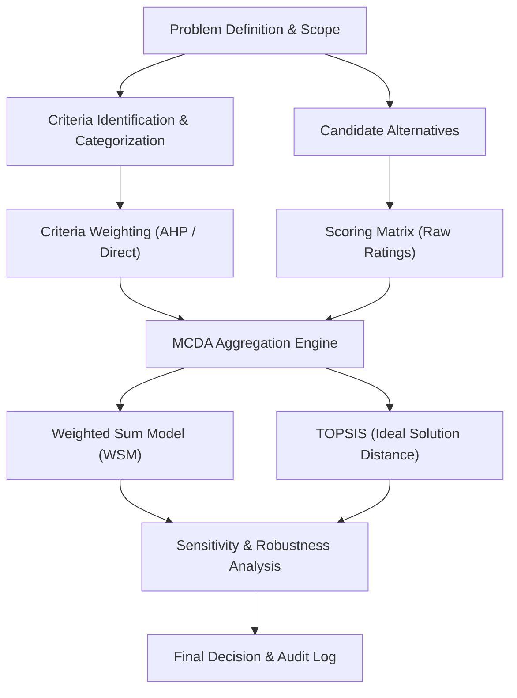
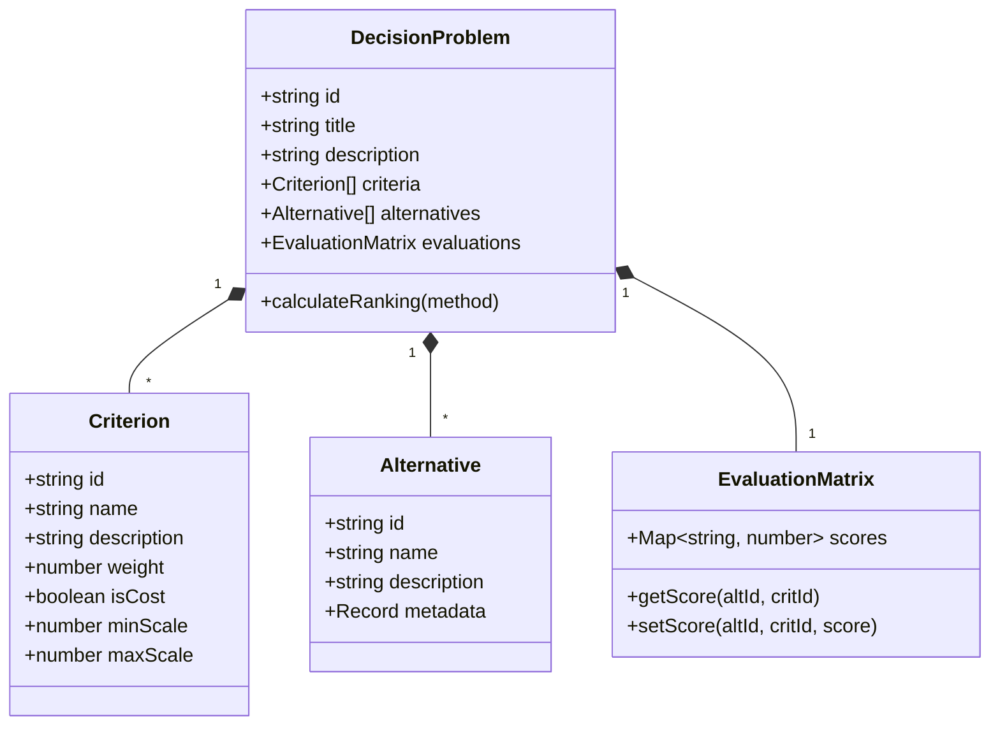

# Real-Life Decision Platform - System Architecture

## 1. Executive Summary
The **Real-Life Decision Platform** is designed to eliminate cognitive bias, decision paralysis, and emotional regret when making consequential personal or professional choices (e.g. career moves, real estate investments, technology stack choices, medical treatment paths, company strategy).

---

## 2. Core Mathematical & Methodological Models

### 2.1 Multi-Criteria Decision Analysis (MCDA) Methods
1. **Weighted Sum Model (WSM):**
   $$S_i = \sum_{j=1}^{m} w_j \cdot v_{ij}$$
   Where $w_j$ is the normalized weight of criterion $j$ ($\sum w_j = 1$), and $v_{ij}$ is the normalized score of alternative $i$ on criterion $j$.

2. **Analytic Hierarchy Process (AHP):**
   - Pairwise comparison matrices for criteria and alternatives.
   - Eigenvector calculation for priority weights.
   - **Consistency Ratio (CR):** Verification that pairwise judgments are consistent ($CR < 0.10$).

3. **TOPSIS (Technique for Order of Preference by Similarity to Ideal Solution):**
   - Calculates Euclidean distance to the Positive-Ideal Solution ($A^*$) and Negative-Ideal Solution ($A^-$).
   - Relative closeness determines the final ranking.

4. **Sensitivity Analysis:**
   - Evaluates: "By how much must criterion weight $w_k$ change before Option A is surpassed by Option B?"

---

## 3. Domain Model Entities

---

## 4. Technology Stack Recommendations
- **Core Engine:** TypeScript / JavaScript (Node.js) or Python 3.11+ for clean mathematical precision and interoperability.
- **Frontend / Interface:** Next.js / React with Tailwind CSS, or lightweight web dashboard.
- **Data Persistence:** JSON / SQLite for portable, zero-overhead local-first storage.
